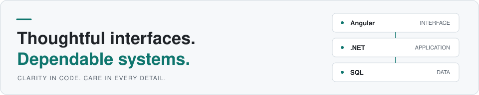
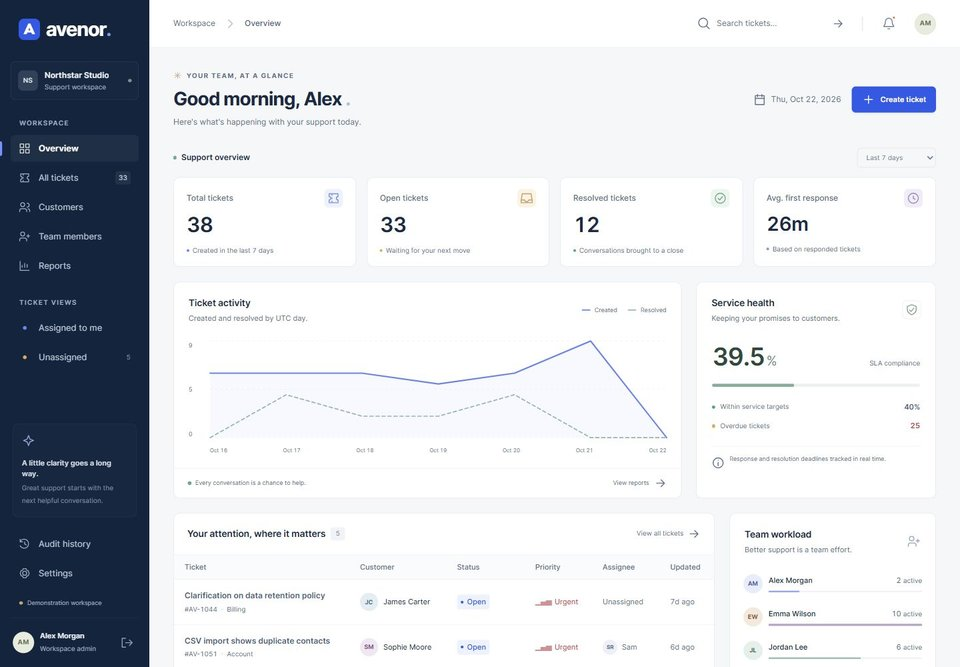
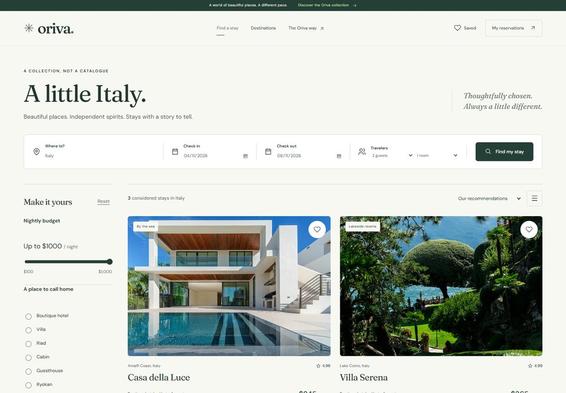
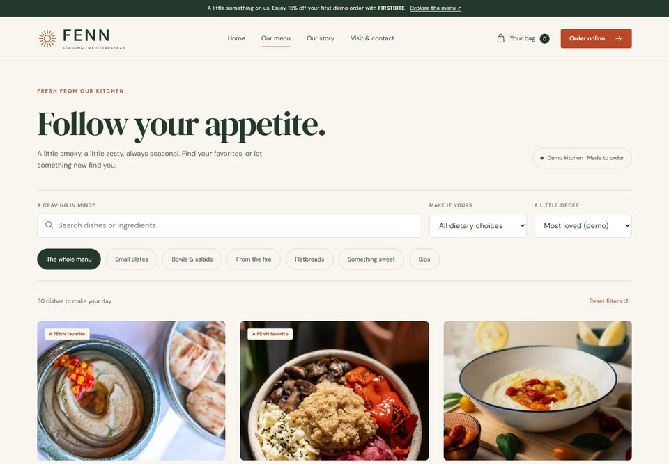
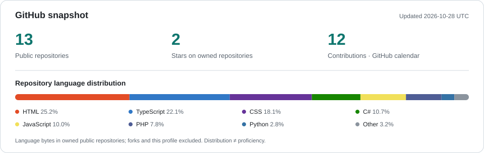
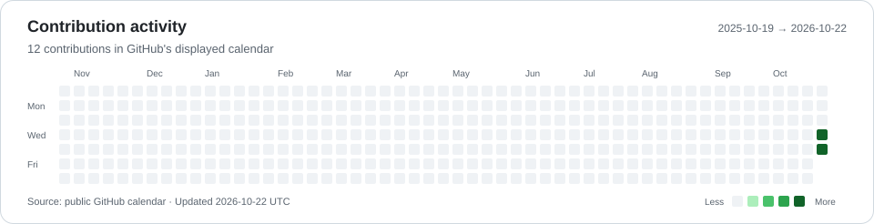

# Khalid Saleh

**Full-Stack .NET & Angular Developer** · Alexandria, Egypt  
[LinkedIn](https://www.linkedin.com/in/kd9sa/) · [GitHub](https://github.com/KD9Sa)

<picture>
  <source media="(max-width: 600px) and (prefers-color-scheme: dark)" srcset="assets/hero-mobile-dark.svg">
  <source media="(max-width: 600px)" srcset="assets/hero-mobile-light.svg">
  <source media="(prefers-color-scheme: dark)" srcset="assets/hero-dark.svg">
  <source media="(prefers-color-scheme: light)" srcset="assets/hero-light.svg">
  
</picture>

I build modern web applications with **Angular, C#, and ASP.NET Core**, connecting thoughtful user experiences with well-structured APIs and relational data. I'm passionate about making software **scalable, secure, maintainable, and clear to work with**.

My computer engineering background shapes how I approach problems—from the interface people use to the architecture and business rules behind it.

[Featured projects](#featured-projects) · [Technical stack](#technical-stack) · [Engineering approach](#engineering-approach) · [GitHub activity](#github-activity)

## Technical stack

**Frontend**

  &nbsp;&nbsp;
  &nbsp;&nbsp;
  &nbsp;&nbsp;
  &nbsp;&nbsp;
  

HTML · CSS · JavaScript · TypeScript · Angular

**Backend & data**

  &nbsp;&nbsp;
  &nbsp;&nbsp;
  &nbsp;&nbsp;
  

C# · .NET / ASP.NET Core · Entity Framework Core · SQL Server

**Development & delivery**

  &nbsp;&nbsp;
  

Git · Docker

## Featured projects

### [Avenor — Customer Support Workspace](https://github.com/KD9Sa/Avenor)

A full-stack, multi-tenant support application bringing ticket queues, customer conversations, team operations, and administration into one workspace.

**Angular · TypeScript · ASP.NET Core · EF Core · SQL Server**

- **Architecture:** Separate Domain, Application, Infrastructure, and API layers.
- **Security & consistency:** Tenant-scoped data access, role-based permissions, session protection, and optimistic concurrency.
- **Verification:** Domain and API tests for business rules, access boundaries, and conflicting updates.

### [Oriva — Accommodation Booking Demo](https://github.com/KD9Sa/Oriva)

An editorial-style Angular experience for discovering stays, saving favorites, and completing a simulated reservation flow with browser-local persistence.

**Angular · TypeScript · Signals · Reactive Forms · Vitest · Playwright**

- Lazy-loaded pages with search, filtering, sorting, and URL-backed discovery state.
- Validated dates, guest capacity, and overlapping reservations; pricing calculated in integer cents.
- Resilient local storage, unit tests, and browser tests for booking journeys and responsive interactions.

  
Preview Oriva's accommodation discovery interface

   
  

### [FENN — Restaurant Ordering Demo](https://github.com/KD9Sa/FENN)

A responsive restaurant experience spanning menu discovery, dish customization, a persistent cart, simulated checkout, and order tracking.

**HTML · CSS · JavaScript · ES Modules · Node.js Test Runner**

- Modular cart, pricing, storage, and validation logic, with integer-cent totals.
- Saved carts revalidated against current menu data, with updates synchronized across browser tabs.
- Business-logic tests and accessible native interactions across the ordering flow.

  
Preview FENN's menu and ordering interface

   
  

**Also explore:** [Meridian](https://github.com/KD9Sa/Meridian) — a six-page HTML, CSS, and SVG dashboard concept with a documented design system, container queries, and coordinated light and dark themes.

## Engineering approach

- **Keep code understandable.** Apply Clean Code, SOLID principles, and design patterns where they clarify responsibilities and make change easier.
- **Design clear boundaries.** Separate business rules, presentation, API contracts, and persistence; let requirements guide the architecture.
- **Build security into the workflow.** Treat validation, authorization, tenant isolation, and error handling as part of the feature.
- **Make quality observable.** Test meaningful behavior, consider performance in data access and rendering, and document decisions and tradeoffs.

## AI-assisted workflow

I use **ChatGPT Codex, Claude, and Gemini Antigravity** to improve productivity, accelerate development, and strengthen code quality—from exploring approaches and scaffolding features to reviewing changes and refining tests.

I keep engineering judgment at the center: define constraints, inspect generated changes, verify behavior, and review security and architecture before accepting a solution. AI assistance supports the same standards I apply to code I write directly.

## GitHub activity

<a href="https://github.com/KD9Sa?tab=repositories">
  <picture>
    <source media="(max-width: 600px) and (prefers-color-scheme: dark)" srcset="assets/metrics/overview-mobile-dark.svg">
    <source media="(max-width: 600px)" srcset="assets/metrics/overview-mobile-light.svg">
    <source media="(prefers-color-scheme: dark)" srcset="assets/metrics/overview-dark.svg">
    <source media="(prefers-color-scheme: light)" srcset="assets/metrics/overview-light.svg">
    
  </picture>
</a>

<a href="https://github.com/KD9Sa?tab=overview">
  <picture>
    <source media="(max-width: 600px) and (prefers-color-scheme: dark)" srcset="assets/metrics/activity-mobile-dark.svg">
    <source media="(max-width: 600px)" srcset="assets/metrics/activity-mobile-light.svg">
    <source media="(prefers-color-scheme: dark)" srcset="assets/metrics/activity-dark.svg">
    <source media="(prefers-color-scheme: light)" srcset="assets/metrics/activity-light.svg">
    
  </picture>
</a>

Generated daily from GitHub's public API and contribution calendar. Language shares measure repository code bytes, not proficiency; forks and this profile repository are excluded. Each chart shows its snapshot date.

## Let's connect

Interested in .NET, Angular, software architecture, or a project? Find me on [LinkedIn](https://www.linkedin.com/in/kd9sa/) or explore my [public repositories](https://github.com/KD9Sa?tab=repositories).
